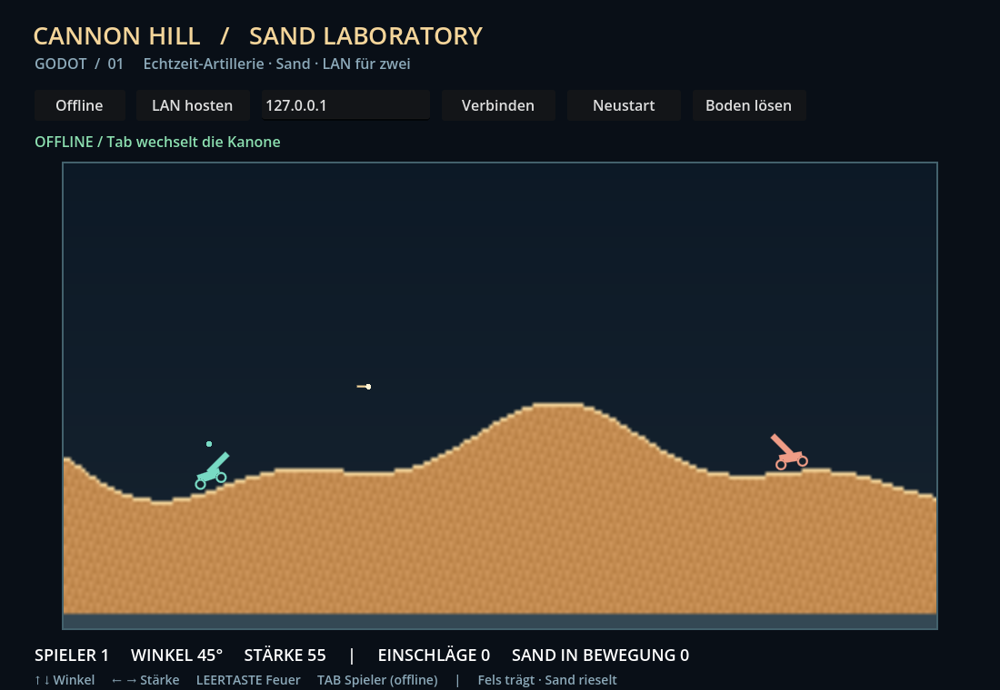

# Cannon Hill clone — Sand Laboratory

Eigenständiger, assetfreier 2D-Artillerieprototyp für **Unity, Godot und Unreal**.
Ziel: zwei Spieler in Echtzeit über LAN, rieselnder Sand, tragender Untergrund und ballistische Geschosse.
Das historische Original ist noch nicht eindeutig identifiziert. Keine Originaldateien oder fremder Spielcode sind enthalten.

## Sofort ausprobieren: Godot

`godot/project.godot` mit Godot 4.7.2 öffnen und **F6/F5** starten (Hauptszene: `main.tscn`).
Oder in PowerShell bzw. unter macOS (`brew install --cask godot` legt `godot` in den PATH):

```powershell
godot --path C:\GitHub\CannonHill_clone\godot
```

```bash
godot --path ~/GitHub/cannonhill_clone/godot
```

- **↑ / ↓:** Winkel; **← / →:** Stärke; **Leertaste:** schießen.
- **Tab:** offline zwischen beiden Kanonen wechseln. Es gibt keine Rundenpflicht.
- **Boden lösen:** Sand unter der ausgewählten Kanone entfernen und Absacken beobachten.
- **Neustart:** Welt zurücksetzen (offline oder beim Host).
- Zum Steuern den Fokus aus dem IP-Eingabefeld nehmen (**Esc**).
- Godot zeigt eine kurze Flugbahnvorschau, Ladebalken und Stärkeanzeige; Schuss und Einschlag haben Sound, Trümmer, Blitz und Kamerawackeln. Der Client rekonstruiert diese Effekte aus den Snapshots und zeichnet Geschosse zwischen zwei Zuständen ballistisch weiter. Protokoll und Simulation bleiben unverändert (v1).

## LAN für zwei Spieler

1. Auf PC 1 **LAN hosten** drücken. Der Host spielt die linke Kanone.
2. Auf PC 2 die lokale IPv4-Adresse von PC 1 eingeben und **Verbinden** drücken.
3. Der Client spielt die rechte Kanone; beide können gleichzeitig schießen.

TCP-Port **28741**, maximal ein Client. Im vertrauenswürdigen LAN muss die lokale Firewall die Verbindung erlauben. Dieses Projekt verändert keine Firewallregeln. Kein Router-Portforwarding notwendig. `127.0.0.1` dient dem Test mit zwei Instanzen auf demselben Rechner.

Der Host berechnet Sand, Kanonen und Geschosse mit 30 Hz; der Client erhält maximal zehn vollständige Zustände pro Sekunde. Version 1 des Protokolls ist engineübergreifend ausgelegt. Tatsächlich geprüfte Kombinationen stehen in [VALIDATION.md](docs/VALIDATION.md). Keine Anmeldung, Internetsuche, Lobby oder automatische Wiederverbindung.

## Drei Engines, ein Repository

| Ordner | Einstieg |
|---|---|
| `godot/` | `project.godot` öffnen und F5 |
| `unity/` | In Unity Hub als Projekt hinzufügen; Unity **6000.6.3f1**; Menü **Cannon Hill → Create or open sandbox**, dann Play |
| `unreal/` | C++-Quellprojekt für UE **5.4+**; `.uproject` einer installierten Engine zuordnen, Projektdateien erzeugen, Development Editor kompilieren und Play |
| `shared/` | Gemeinsame Maße, Regeln und Netzwerkformat |
| `shared/assets/` | Kleine, engineneutrale Assets in Git (z. B. `audio/fire.wav`), von allen Engines direkt gelesen |
| `asset-manifests/` | Asset-IDs → Pfade, Größen und SHA-256 für `shared/assets/` und USB-Pakete |
| `external-assets/` | Ignorierter Ablageplatz für große Pakete |

Unreal benötigt zusätzlich den zur gewählten Engine passenden C++-Compiler und das Windows SDK. Diese werden nicht automatisch installiert. Der Unreal-Prototyp zeichnet die 2D-Welt im HUD und benötigt keine eigenen binären Maps. Startmap ist die mit der Engine gelieferte Entry-Map.

**Unreal-Steuerung:** Pfeile, Leertaste und Tab wie oben; **H** hosten, **J** verbinden, **O** offline, **R** Neustart, **B** Boden lösen. Für einen anderen Host die Spielinstanz mit `-Join=192.168.x.x` starten; J nutzt dieselbe Adresse. Unity und Godot haben ein IP-Eingabefeld.

## Was die Physik bereits modelliert

- Zellulärer Sand: freier Fall, diagonales Nachrutschen und Krater; fester Felsboden.
- Zwei vereinfachte Kanonen mit Schwerkraft, Radstützpunkten und grafischer Neigung.
- Geschosse mit Schwerkraft, Kollisions-Unterteilung, Einschlag und 0,7 Sekunden Nachladezeit.
- Ausschließlich prozedurale Farben und Geometrie, keine Assetdownloads.

Dies ist ein **gemeinsames Referenzmodell**, kein Vergleich von Unity Physics, Godot Physics und Unreal Chaos. Kanonen kippen und rollen noch nicht frei, Sand übt keinen realistischen Druck aus; Treffer beschädigen noch keine Kanonen. Unterschiede bei Gleitkommazahlen sind möglich, weshalb nur der Host simuliert. Die grafische Darstellung ist absichtlich klein gehalten; Beleuchtung, Partikel und höherwertige Grafik folgen später.

## Gemeinsam entwickeln

Vorerst übernimmt Robert alle Aufgaben. [TODO.md](TODO.md) enthält spätere, nach Dateien abgegrenzte Aufgaben und Abnahmekriterien. Die Issues auf GitHub sind die verbindliche Reservierung: **erst zuweisen, dann beginnen**, pro Aufgabe ein Branch und Pull Request. Globale Einstellungen und Integrationsszenen werden jeweils nur von einer Person geändert. Eine Aufgabenliste oder CODEOWNERS stellt keine technische Dateisperre dar.

Ein öffentliches Repository kann dein Kollege sofort lesen und klonen. Für Schreibzugriff muss sein GitHub-Benutzername oder seine E-Mail-Adresse gezielt eingeladen werden; es gibt hier keinen allgemeinen Beitrittslink.

## Große Assets per USB

Alle Engines adressieren Assets über eine **ID** aus `asset-manifests/assets.json` (z. B. `audio.impact`), nicht über engineeigene Kopien. Kleine eigene Dateien liegen einmalig unter `shared/assets/`, große USB-Pakete unter `external-assets/<paket>-vNNN/`. Godot liest beides zur Laufzeit über `godot/shared_assets.gd` (Repo-Root automatisch, sonst Umgebungsvariable `CANNONHILL_ROOT`) und prüft die Prüfsumme; fehlt eine Datei, läuft das Spiel ohne sie weiter. Die Sounds erzeugt `python3 tools/generate_shared_audio.py --manifest` deterministisch neu.

Kleine eigene Szenen, Code, Projektkonfiguration und Referenz-Metadaten bleiben in Git. Große Pakete werden unter stabilen Pfaden und mit Versionsnummer per USB ausgetauscht. Das Manifest im Repository enthält Zielpfad, Herkunft, Lizenz, Dateigröße und SHA-256. Details: [USB_ASSETS.md](docs/USB_ASSETS.md).

## Prüfen und bauen

macOS/Linux:

```bash
godot --headless --path godot --script res://tests/smoke.gd
```

```bash
tools/test-lan.sh
```

Windows:

```powershell
godot --headless --path .\godot --script res://tests/smoke.gd
.\tools\Test-Lan.ps1
.\tools\Test-EnginePair.ps1 -HostEngine unity -ClientEngine godot
.\tools\Test-EnginePair.ps1 -HostEngine godot -ClientEngine unity
& 'C:\Program Files\Unity 6000.6.3f1\Editor\Unity.exe' -batchmode -nographics -quit -projectPath "$PWD\unity" -executeMethod ProjectSetup.Build -logFile "$PWD\reports\unity-build.log"
```

Builds, Logs und Screenshots bleiben lokal in `builds/` und `reports/`. Engine-Caches sind ignoriert. Teststand und Grenzen: [VALIDATION.md](docs/VALIDATION.md).


