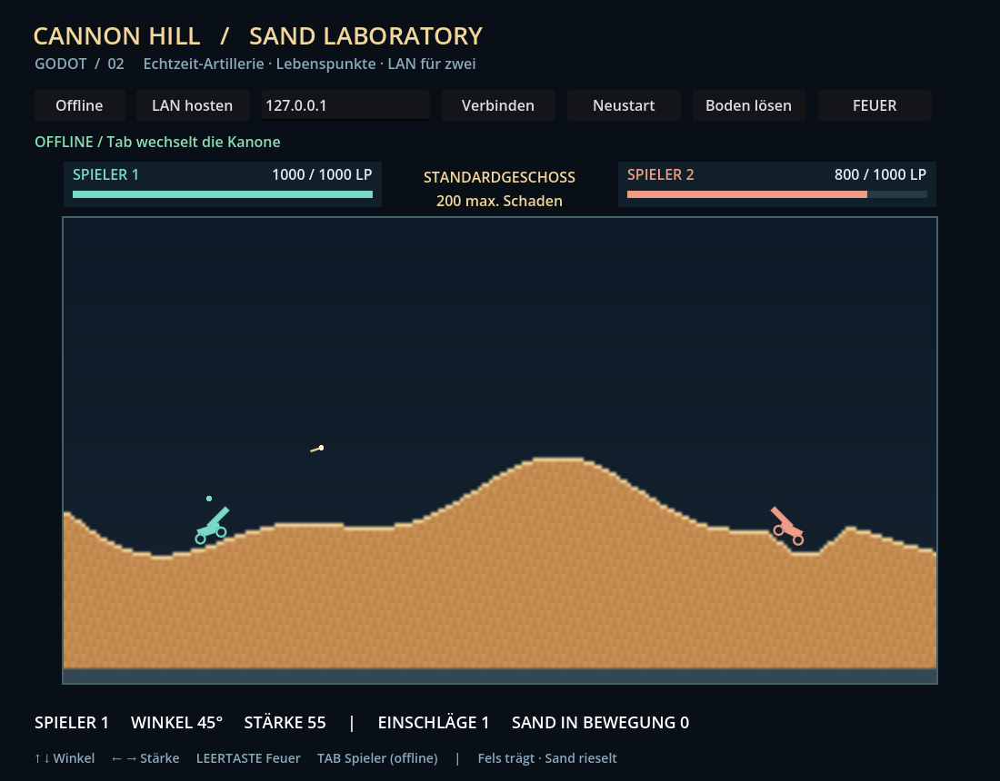

# Cannon Hill clone — Sand Laboratory

Eigenständiger, assetfreier 2D-Artillerieprototyp für **Unity, Godot und Unreal**.
Ziel: zwei Spieler in Echtzeit über LAN, rieselnder Sand, tragender Untergrund und ballistische Geschosse.
Als Referenz ist jetzt **Cannonhill von Dirk Plate** identifiziert. Die belegten Waffen und Hilfsmittel stehen in [CANNONHILL_REFERENCE.md](docs/CANNONHILL_REFERENCE.md). Keine Originaldateien oder fremder Spielcode sind enthalten.

Godot, Unity und Unreal haben Lebenspunkte, Rundenergebnisse und fallende Buff-Kisten. Unreal bietet auch Fahren und drei Geschosstypen.

## Unreal 5.8: Fahren und Waffenwahl

`unreal 5.8/CannonHill.uproject` im Editor oeffnen, Play starten und den Spielbereich anklicken.

- **A / D:** fahren; steile Kanten und die andere Kanone blockieren. Kein Antrieb in der Luft.
- **1 / 2 / 3:** Standard / Schwer / Schnell. Kraterradius: 10 / 16 / 5 Zellen; Nachladen: 0,7 / 1,4 / 0,3 Sekunden. Unbegrenzte Munition. Schnellfeuer halbiert die Nachladezeit der gewählten Waffe.
- **Pfeile:** Winkel und Staerke; **Leertaste:** feuern; **Tab:** offline Kanone wechseln.
- **H / J:** LAN hosten / verbinden. Beide Unreal-Spieler brauchen diesen Stand mit Protokoll **v6**, inkompatibel mit Godot v4 und alten v1-Clients.

Gameplay-Quellen sind auch in `unreal/Source` enthalten. Die Targets in `unreal 5.8/Source` sind fuer UE 5.8 angepasst.

## Sofort ausprobieren: Godot

`godot/project.godot` mit Godot 4.7.2 öffnen und **F6/F5** starten (Hauptszene: `main.tscn`).
Oder in PowerShell, wenn `godot` im PATH liegt:

```powershell
godot --path C:\GitHub\CannonHill_clone\godot
```

- **↑ / ↓:** Winkel; **← / →:** Stärke; **Leertaste** oder **FEUER:** schießen.
- **Tab:** offline zwischen beiden Kanonen wechseln. Es gibt keine Rundenpflicht.
- **Boden lösen:** Sand unter der ausgewählten Kanone entfernen und Absacken beobachten.
- Beide Kanonen starten mit **1.000 Lebenspunkten**. Direkte Treffer verursachen 200 Schaden; nahe Einschläge weniger, auch an der eigenen Kanone.
- Bei null Lebenspunkten ist die Kanone zerstört. Die Runde endet mit Gewinner oder Unentschieden bei gleichzeitiger Zerstörung. Danach kann niemand mehr feuern.
- **Neustart:** Welt, Lebenspunkte und Rundenergebnis zurücksetzen (offline oder beim Host).
- Zum Steuern den Fokus aus dem IP-Eingabefeld nehmen.

In allen drei Fassungen fällt alle fünf Sekunden eine Kiste nahe der Spielfeldmitte. Triff sie mit einem Schuss, bevor sie den Boden erreicht. Reparatur bringt bis zu 150 LP. Schild halbiert den Schaden für acht Sekunden, Schnellfeuer halbiert acht Sekunden lang die Nachladezeit. Im LAN entscheidet der Host, wer die Kiste trifft.

## Gemeinsame LAN-Partie

Der Rust-Server ermöglicht gemischte Partien zwischen Browser, Godot, Unity und Unreal. Unter Windows den Host mit `.\rust-web\Start.ps1 -Lan` starten. Unter macOS `sh rust-web/start.sh --lan` verwenden.

- Im Browser `http://HOST-IP:8000` öffnen.
- In Godot und Unity `ws://HOST-IP:8000/ws` ins Adressfeld eintragen und **Verbinden** wählen.
- Unreal mit `-RustServer=ws://HOST-IP:8000/ws` starten.

Die erste Verbindung erhält Spieler 1 und kann die Runde neu starten. Die gemischte Partie verwendet den Rust-Regelsatz mit der Standardwaffe. [Start und Prüfungen](rust-web/README.md).

## LAN für zwei Spieler

Beide Rechner ins gleiche Heimnetz bringen (WLAN oder Kabel). Beide starten dieselbe Engine mit demselben Spielstand: Godot v4, Unity v5 oder Unreal v6. Die Protokolle sind untereinander inkompatibel.

Unter Windows im Projektordner auf Rechner 1:

```powershell
.\tools\Start-Lan.ps1 -Engine Godot -Role Host
```

Der Starter zeigt die IPv4-Adressen der aktiven Adapter. Gib deinem Freund die Adresse deines WLAN- oder Ethernet-Adapters. Rechner 2 startet mit dieser Adresse (hier ein Beispiel):

```powershell
.\tools\Start-Lan.ps1 -Engine Godot -Role Join -Address 192.168.178.42
```

Setzt beide `-Engine Unity` oder beide `-Engine Unreal`, wenn ihr diese Fassung spielen wollt. Der Starter erwartet Godot im PATH, die Unity-EXE unter `builds/unity/CannonHill.exe` bzw. das kompilierte Unreal-5.8-Projekt. Bei einer anderen Unreal-Installation gib `-UnrealEditor` mit dem Pfad zur Editor-EXE an.

Alternativ: In Godot und Unity **LAN hosten** wählen. Am zweiten Rechner die Host-IP eingeben und **Verbinden** anklicken. In Unreal startet **H** den Host. Den Unreal-Client mit `-Join=<Host-IP>` starten.

Der Host steuert die linke Kanone, der Gast die rechte. Der Host berechnet die Spielwelt und schickt den Zustand an den Gast. Es gibt Platz für einen Gast pro Partie.

Wenn die Verbindung nicht klappt, prüft am Host zuerst die Firewall für **TCP 28741** im privaten Netz. Gäste-WLAN kann Verbindungen zwischen Geräten blockieren. `127.0.0.1` ist für zwei Instanzen auf demselben Rechner. Im Heimnetz braucht ihr keine Portweiterleitung. Verbindungen zwischen getrennten Heimnetzen sind hier nicht eingerichtet.

## Drei Engines, ein Repository

| Ordner | Einstieg |
|---|---|
| `godot/` | `project.godot` öffnen und F5 |
| `unity/` | In Unity Hub als Projekt hinzufügen; Unity **6000.6.3f1**; Menü **Cannon Hill → Create or open sandbox**, dann Play |
| `unreal 5.8/` | Getestetes C++-Projekt für UE **5.8**. Development Editor kompilieren und Play starten |
| `shared/` | Gemeinsame Maße, Regeln und Netzwerkformat |
| `asset-manifests/` | Versions- und Prüfsummenlisten für spätere USB-Pakete |
| `external-assets/` | Ignorierter Ablageplatz für große Pakete |

Unreal benötigt zusätzlich den zur gewählten Engine passenden C++-Compiler und das Windows SDK. Diese werden nicht automatisch installiert. Der Unreal-Prototyp zeichnet die 2D-Welt im HUD und benötigt keine eigenen binären Maps. Startmap ist die mit der Engine gelieferte Entry-Map.

**Unreal-Steuerung:** Pfeile, Leertaste und Tab wie oben; **H** hosten, **J** verbinden, **O** offline, **R** Neustart, **B** Boden lösen. Für einen anderen Host die Spielinstanz mit `-Join=192.168.x.x` starten; J nutzt dieselbe Adresse. Unity und Godot haben ein IP-Eingabefeld.

## Was die Physik bereits modelliert

- Zellulärer Sand: freier Fall, diagonales Nachrutschen und Krater; fester Felsboden.
- Zwei vereinfachte Kanonen mit Schwerkraft, Radstützpunkten und grafischer Neigung.
- Geschosse mit Schwerkraft, Kollisions-Unterteilung, Einschlag und 0,7 Sekunden Nachladezeit.
- Ausschließlich prozedurale Farben und Geometrie, keine Assetdownloads.

Dies ist ein **gemeinsames Referenzmodell**, kein Vergleich von Unity Physics, Godot Physics und Unreal Chaos. Kanonen kippen und rollen noch nicht frei; Unreal bietet einen vereinfachten Fahrantrieb, Sand übt keinen realistischen Druck aus. Alle drei Fassungen modellieren Schaden, Reparatur und Schild. Unterschiede bei Gleitkommazahlen sind möglich, weshalb nur der Host simuliert. Die grafische Darstellung ist absichtlich klein gehalten; Beleuchtung, Partikel und höherwertige Grafik folgen später.

## Gemeinsam entwickeln

Die [lokale Aufgabenübersicht](docs/aufgaben/README.md) zeigt den Stand laufender Arbeiten. Der [Ablauf für die Projektbetreuung](docs/HUMANLAYER.md) verbindet Analyse, Plan, Umsetzung und Review im Checkout. Für die gemeinsame Arbeit an GitHub gelten die folgenden Regeln.

Vorerst übernimmt Robert alle Aufgaben. [TODO.md](TODO.md) enthält spätere, nach Dateien abgegrenzte Aufgaben und Abnahmekriterien. Die Issues auf GitHub sind die verbindliche Reservierung: **erst zuweisen, dann beginnen**, pro Aufgabe ein Branch und Pull Request. Globale Einstellungen und Integrationsszenen werden jeweils nur von einer Person geändert. Eine Aufgabenliste oder CODEOWNERS stellt keine technische Dateisperre dar.

Ein öffentliches Repository kann dein Kollege sofort lesen und klonen. Für Schreibzugriff muss sein GitHub-Benutzername oder seine E-Mail-Adresse gezielt eingeladen werden; es gibt hier keinen allgemeinen Beitrittslink.

## Große Assets per USB

Kleine eigene Szenen, Code, Projektkonfiguration und Referenz-Metadaten bleiben in Git. Große Pakete werden unter stabilen Pfaden und mit Versionsnummer per USB ausgetauscht. Das Manifest im Repository enthält Zielpfad, Herkunft, Lizenz, Dateigröße und SHA-256. Details: [USB_ASSETS.md](docs/USB_ASSETS.md).

## Prüfen und bauen

```powershell
godot --headless --path .\godot --script res://tests/smoke.gd
.\tools\Test-Lan.ps1
.\tools\Test-GodotHealthLan.ps1
& 'C:\Program Files\Unity 6000.6.3f1\Editor\Unity.exe' -batchmode -nographics -quit -projectPath "$PWD\unity" -executeMethod ProjectSetup.Build -logFile "$PWD\reports\unity-build.log"
```

Builds, Logs und Screenshots bleiben lokal in `builds/` und `reports/`. Engine-Caches sind ignoriert. Teststand und Grenzen: [VALIDATION.md](docs/VALIDATION.md).

`Test-EnginePair.ps1` startet zwei Prozesse derselben Engine. Godot und Unity verwenden unterschiedliche LAN-Protokolle.


