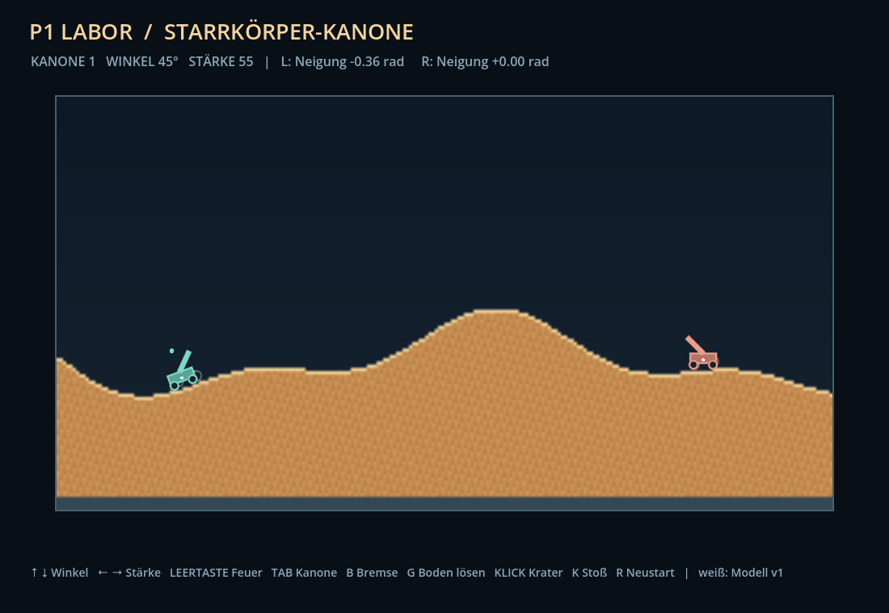
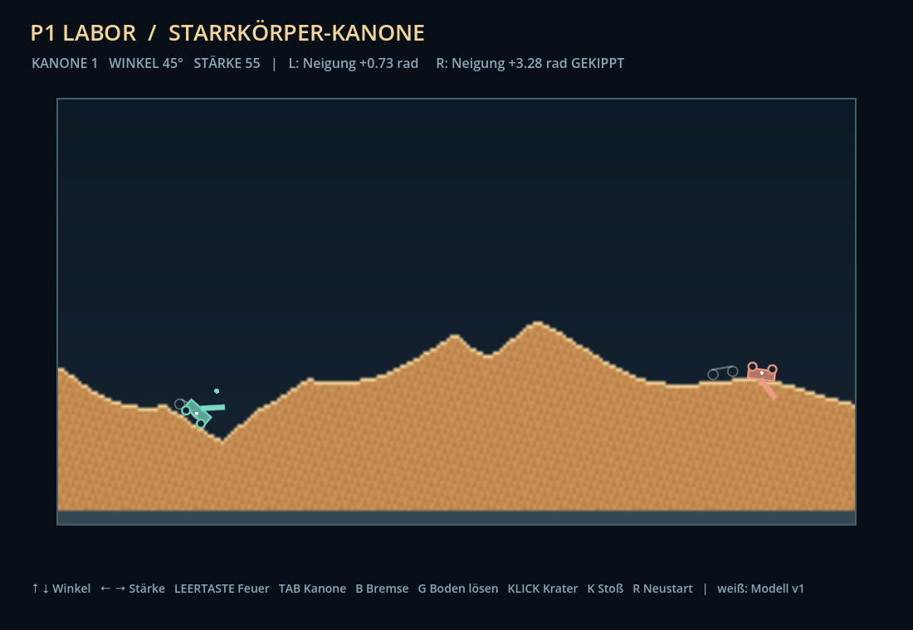

# P1-Vorschlag: Kanone als freier Starrkörper

Status: **In Godot integriert (Protokoll v3)**, Unity/Unreal noch auf v1. Bezug: Issue 3, `TODO.md` P1.

## Entscheidung: eigener Solver statt nativer Enginephysik

| Kriterium | Eigener Solver (gewählt) | Godot Physics / PhysX / Chaos |
|---|---|---|
| Gleiche Ergebnisse in allen drei Engines | Gleicher Algorithmus, gleiche Konstanten, Zeile für Zeile portierbar | Drei verschiedene Solver, nicht vergleichbar |
| Boden aus 30 720 Sandzellen, der sich jeden Tick ändert | Fragt direkt `solid(x, y)` ab | Kollisionsformen müssten nach jedem Krater neu gebaut werden |
| LAN hostautoritativ | Host rechnet, sieben Zahlen pro Kanone im Snapshot | Möglich, aber die Clients bräuchten trotzdem einen Abgleich |
| Aufwand | Etwa 150 Zeilen | Wenig Code, aber Abstimmung je Engine |

Native Physik bleibt für spätere, rein grafische Effekte möglich (Trümmer usw.), nicht für spielrelevante Zustände.

## Modell

Referenz: `godot/rigid_cannon.gd`. Einheiten wie Spezifikation v1: Zellen, Sekunden, y nach unten. Winkel in rad, positiv im Uhrzeigersinn auf dem Bildschirm.

- **Körper:** Masse 1, Chassis 8 × 4 Zellen, Trägheitsmoment `m(8² + 4²)/12`. Zustand: `x, y, vx, vy, angle, spin, brake`.
- **Kontaktpunkte im Körpersystem:** Räder `(±3, 3)`, entspricht der Auflage aus v1. Rumpf `(±4, 1)`, `(±4, −2)`, `(0, −2)`. Der Rumpf berührt den Boden erst bei starker Neigung, auf der Seite oder auf dem Dach.
- **Zeitschritt:** 1/30 s wie v1, intern 8 Teilschritte. Pro Teilschritt:
  1. `vy += g·h`
  2. Kontakte sammeln: Ein Punkt berührt den Boden, wenn er selbst oder der Punkt 0,1 Zellen darunter fest ist.
  3. Vier Iterationen Impulsauflösung mit Stoßzahl 0,05 und Coulomb-Reibung.
  4. Integrieren, Drehdämpfung 0,6/s.
  5. 30 % der Resteindringung entlang der Normalen herausschieben.
- **Normale:** Summe der Richtungen von den festen Zellen im 5×5-Umfeld zum Kontaktpunkt, normiert. Ohne Ergebnis gilt „oben“. Sand und Fels tragen gleich.
- **Reibung:** Rad gebremst 0,9, ungebremst 0,03 (rollt frei), Rumpf 0,6.
- **Rückstoß (Vorschlag):** Impuls `−Richtung × Schussstärke × 0,03` an der Mündung. Bei Stärke 55 sind das etwa 1,6: Die Kanone schaukelt, kippt aber nicht. Das Rohr zielt relativ zum Chassis, eine geneigte Kanone schießt also entsprechend geneigt.
- **Sand:** Die Kanone liest den Sand nur. Sie verdrängt keinen Sand und übt keinen Druck aus (wie v1).

## Tests

`godot --headless --path godot --script res://tests/rigid_cannon_test.gd`. 19 Prüfungen, alle bestanden (macOS, Godot 4.7.2, 30.10.2026):

| Fall | Erwartung |
|---|---|
| Ebene | Aufrecht, ruhig, nur zwei Radkontakte |
| Hang 1:3 (18°) | Chassis folgt dem Hang (±0,08 rad). Gebremst hält es, ungebremst rollt es bergab |
| Einseitig entfernte Auflage | Schmale Grube unter einem Rad: Neigung > 0,3 rad, bleibt aufrecht, kommt zur Ruhe. Schwerpunkt über breiter Grube: lehnt > 0,7 rad hinein, kippt nicht ganz |
| Kante | Liegt der Schwerpunkt jenseits der Kante, kippt die Kanone und fällt auf die untere Ebene |
| Vollständiger Bodenverlust | Freier Fall ohne Kontakt, landet aufrecht unten |
| Fall aus 20 Zellen | Kein Rückprall, kein Durchtunneln |
| Rückstoß | 1,5 schaukelt zurück, 10 kippt aufs Dach |
| Echter Sand | Ruht auf dem Standardgelände. Einseitig untergraben: sinkt und neigt sich zum Loch |
| Snapshot | Fortsetzung nach Übernahme ist bitgenau gleich, Zustand bleibt endlich |

## Sichtbar machen

```bash
godot --path godot res://lab/tipping_lab.tscn
```

Das Labor läuft offline auf der normalen Sandwelt. Das v1-Modell wird als weißer Umriss zum Vergleich mitgerechnet. Tasten: G Boden lösen, Klick Krater, K Stoß, B Bremse, Leertaste Feuer mit Rückstoß. Der automatische Lauf `-- --smoke --capture-at=N --capture=pfad.png` untergräbt die linke Kanone, feuert beide und stößt die rechte um.

| Vorher (v1-Startzustand, Tick 25) | Nachher (Tick 200) |
|---|---|
|  |  |

Ergebnis des Laufs: links +0,73 rad, bleibt aufrecht in der untergrabenen Mulde (der v1-Umriss bleibt oben hängen). Rechts nach dem Stoß 3,28 rad, auf dem Dach.

## LAN

Hostautoritativ wie bisher: Nur der Host rechnet den Starrkörper. Ein späteres Protokoll ersetzt pro Kanone `vy`/`tilt` durch `x, y, vx, vy, angle, spin, brake`. Das liefert `RigidCannon.snapshot()`, etwa 100 Byte pro Kanone. Clients übernehmen den Zustand unverändert. Der Snapshot-Test zeigt, dass ein übernommener Zustand identisch weiterläuft. Gleitkommaabweichungen zwischen Engines bleiben daher folgenlos.

Umgesetzt als Godot-Protokoll v3 (aufbauend auf v2 mit Gesundheit), siehe `network-protocol.md`.

## Offene Punkte für die Integration

1. ~~`simulation.gd` integrieren~~ erledigt: Rückstoß, Rohr relativ zum Chassis.
2. ~~Gekippte Kanone~~ erledigt: schießt nicht, richtet sich nach 3 s auf.
3. Unity- und Unreal-Port mit denselben Testfällen.
4. Optional: Kanone verdrängt Sand (Druck), Räder als Kreise statt Punkte.
